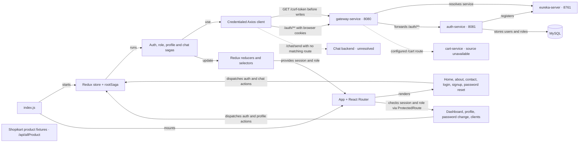

# Shopist UI knowledge graph

## Code and API edges

| UI node | Dependency or API |
| --- | --- |
| [Entry point](src/index.js) → [store](src/redux/store.js) → [root saga](src/redux/sagas/rootSaga.js) | Starts session verification and wires auth, profile, role and chat watchers. |
| [Login](src/components/auth/Login.js) and [auth saga](src/redux/sagas/authSaga.js) → [auth API](src/api/authApi.js) | `POST /auth/login`, then `GET /auth/verifyToken` to confirm the cookie. The same verification endpoint restores the session on page load. |
| [Signup](src/components/auth/SignUp.js), [password reset](src/components/auth/ForgetPassword.js), [password change](src/components/auth/ChangePassword.js) and [header](src/components/Header.js) → auth saga | `POST /auth/register`, `POST /auth/forgot-password`, `POST /auth/change-password` and `POST /auth/logout`. |
| [Profile](src/pages/Profile.js) → [profile saga](src/redux/sagas/profileSaga.js) | `GET /auth/profile` and `PUT /auth/profile`. |
| [Role saga](src/redux/sagas/roleSaga.js) | `GET /auth/roles`. |
| [Home](src/pages/Home.js) → [chatbot](src/components/Chatbot.js) → [chat saga](src/redux/sagas/chatBotSaga.js) | `POST /chat/send`. No matching gateway route was found. |
| [Auth reducer](src/redux/reducers/authReducer.js) → [route guard](src/components/ProtectedRoute.js) | Waits for session verification, then gates access using authentication and, for `/clients`, the `CLIENT` role. API authorization belongs to the backend. |

## First request and cookie lifecycle

1. On load, the UI checks `GET /auth/verifyToken`. The login form and protected routes wait for that check to settle.
2. Before login and every other write, the [Axios client](src/api/axiosConfig.js) waits for `GET /csrf-token` at the gateway root. The browser accepts the server-issued cookie and Axios sends the returned masked token as `X-XSRF-TOKEN`. Concurrent writes can share an in-flight token request. A failed token request stops the write.
3. The auth service sets the `HttpOnly; Secure; SameSite=Strict` authentication cookie. The UI verifies the cookie with `GET /auth/verifyToken` before reporting login success. Logout clears UI session state after the server confirms it. A later write obtains the currently valid CSRF token again.

## Deployment and backend controls

- Development defaults to `http://localhost:8080`. Use the same host name for the UI and gateway. Production defaults to same-origin HTTPS. Route `/csrf-token` and `/auth/**` to the gateway before applying the SPA fallback. Set `REACT_APP_GATEWAY_URL` at build time for a separate gateway origin and keep both origins on the same site for the existing Strict cookie policy.
- The gateway currently allows credentialed CORS for any origin. Before production exposure, restrict this to explicit trusted origins, or remove cross-origin access for a same-origin deployment. Keep auth and CSRF responses out of shared caches.
- Gateway public-route checks use substring matching. Use exact method and path matchers. The auth service ignores several public paths at the filter-chain level and returns `401` for access denial. Keep public routes in the security chain, explicitly require authentication for protected routes, and return `403` for CSRF or authorization failures.
- Enable server-side method security for role and profile checks, verify user-level resource ownership, and keep internal services private. Verify that both Spring CSRF filters accept the same masked header and cookie pair, including after login and logout.
- Verify in a fresh browser profile that a single login submission succeeds, a reload restores the session, logout clears it, and the first write after logout obtains a fresh token. Confirm denied access in the server-side authorization tests.

Backend source and existing project graphs are under [Finworkspace](../../finworkspace/KNOWLEDGE_GRAPH.md). See [Spring Security WebFlux CSRF](https://docs.spring.io/spring-security/reference/reactive/exploits/csrf.html) and the [OWASP CSRF Prevention Cheat Sheet](https://cheatsheetseries.owasp.org/cheatsheets/Cross-Site_Request_Forgery_Prevention_Cheat_Sheet.html).
